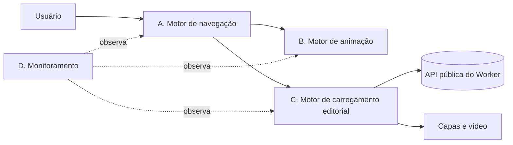

# Especificação de evolução da interface

Entrega 8 da auditoria. Define a arquitetura conceitual futura, separando responsabilidades. Os quatro componentes são **limites conceituais**: não são serviços, não são bibliotecas e não exigem dependências novas. Nenhuma parte foi implementada.

Pré-condição: os achados P0 e P1 de `REGISTRO_DE_ACHADOS.md` estão corrigidos ou aceitos, e as medições de `PLANO_DE_MEDICAO_PERFORMANCE.md` estão feitas como linha de base.

## 1. Visão geral

Os componentes não se chamam diretamente. A navegação informa o estado; o carregamento e a animação reagem a esse estado. O monitoramento só observa.

## 2. Componente A — Motor de navegação

**Responsabilidade:** manter a relação entre a posição do usuário, a URL, o histórico do navegador e o foco.

**Não é responsabilidade dele** trocar o modelo de rolagem da página inteira (ver `ANALISE_NAVEGACAO_HORIZONTAL.md`).

| Item | Definição |
|---|---|
| Entradas | Clique em link, evento `popstate`, âncora (`#faq`), tecla de navegação |
| Saídas | Estado da navegação: seção ativa, URL, posição de rolagem a restaurar |
| Estados | `parado`, `navegando`, `aguardando_conteudo`, `pronto`, `erro` |
| Eventos emitidos | `navegacao:inicio`, `navegacao:pronta`, `navegacao:erro` |
| Erros | Destino inexistente vira `erro`, com a página atual preservada |
| Regras | Toda seção tem URL própria ou âncora estável. O botão Voltar funciona. Foco vai para o título da seção de destino. Nenhum interceptador global de teclado. |
| Dependências | Nenhuma nova |
| Compatibilidade | Âncoras existentes (`#catalogo`, `#nema`, `#faq`, `#sobre`) continuam válidas |
| Testes | Navegação por âncora, Voltar e Avançar, foco após navegação (Playwright) |

## 3. Componente B — Motor de animação

**Responsabilidade:** fornecer os tokens e as regras de movimento descritos em `PADRAO_DE_TRANSICOES.md`, e um único laço de rolagem para as animações dirigidas pela posição.

| Item | Definição |
|---|---|
| Entradas | Eventos de rolagem (um só ouvinte, `passive: true`), preferência de movimento, tamanho da tela |
| Saídas | Variáveis CSS (`--p` por bloco) e classes de estado. Nunca estilo inline por elemento a cada quadro, quando houver alternativa |
| Estados | `desligado` (movimento reduzido), `inativo`, `ativo`, `concluindo` |
| Eventos emitidos | `animacao:iniciada`, `animacao:concluida`, `animacao:cancelada` |
| Erros | Se o cálculo falhar, o bloco vai direto ao estado final |
| Regras | Um laço para todas as animações dirigidas pela rolagem (hoje há dois). `will-change` só enquanto ativa. Parar quando o elemento sai da tela. Estado final garantido. |
| Dependências | Nenhuma |
| Testes | Medição de quadros e de recálculo de estilo (plano de medição); teste de estado final após salto; teste com movimento reduzido |

**Causa dos achados F-01 e F-03:** dois laços de rolagem com reinício próprio, e escrita por elemento a cada quadro. A unificação em um laço com estado terminal explícito corrige as duas classes de problema.

## 4. Componente C — Motor de carregamento editorial

**Responsabilidade:** representar os estados reais de preparação da interface, conforme `ESPECIFICACAO_CARREGAMENTO_EDITORIAL.md`.

| Item | Definição |
|---|---|
| Entradas | Respostas de API (`catalogo`, `slots`, `sessão`), eventos `load` de imagens, tempos limite |
| Saídas | Estado de cada região: `vazio`, `carregando`, `pronto`, `erro`, `vazio_com_dados` |
| Estados | Como na tabela da especificação de carregamento, seção 4 |
| Eventos emitidos | `carregamento:regiao_pronta`, `carregamento:erro`, `carregamento:tentativa` |
| Erros | Falha da API leva a `erro` com botão de nova tentativa. Falha de imagem leva ao título sobre a cor do cartão. |
| Regras | Nenhum percentual. Espera de mais de 400 ms é a única condição de animação de espera. Capas não bloqueiam a interação. Um anúncio por estado. |
| Dependências | Nenhuma |
| Testes | API lenta, API fora, imagem quebrada, retorno com cache |

## 5. Componente D — Monitoramento

**Responsabilidade:** medir desempenho e erros reais, e detectar regressões.

| Item | Definição |
|---|---|
| Entradas | Eventos dos componentes A, B e C; `PerformanceObserver` (LCP, INP, CLS); erros de script e de rede |
| Saídas | Registros agregados enviados ao endpoint de rastreamento existente |
| Estados | Não tem estado de interface |
| Eventos | Nenhum emitido ao usuário |
| Erros | Falha de envio é descartada, sem afetar a página |
| Regras | Sem dados pessoais. Amostragem. Limite de tamanho por registro. |
| Dependências | O endpoint `POST /api/track` já existe; é preciso um tipo de evento próprio |
| Testes | Envio com falha de rede não gera erro visível; amostragem respeitada |

## 6. Interfaces entre componentes

| De | Para | Mensagem | Quando |
|---|---|---|---|
| A | B | `navegacao:pronta` | Destino montado, para reiniciar a revelação |
| A | C | `navegacao:inicio` com a região de destino | Para mostrar o estado de carregamento da região certa |
| C | B | `carregamento:regiao_pronta` | Para revelar os blocos da região |
| B, C | D | eventos de medição | Quando o tempo de animação ou de espera passa do limite |

Eventos são `CustomEvent` no `document`. Nenhum componente acessa o estado interno de outro.

## 7. Critérios de aceite verificáveis

1. A navegação por âncora revela todos os blocos em até 1 s, sem rolar de novo (F-01).
2. Nenhuma animação de espera aparece com a API respondendo em menos de 400 ms.
3. Com movimento reduzido, nenhum laço de rolagem é iniciado e nenhum vídeo é baixado automaticamente (F-02, OK-01).
4. Nenhum elemento fica com `will-change` fora de uma animação ativa (F-04).
5. Nenhum percentual de carregamento é exibido.
6. O botão Voltar leva à página anterior, sem sair do site ao navegar entre seções.
7. Todo controle interativo tem foco visível (F-07).
8. Nenhum listener de rolagem é duplicado: medido por contagem de ouvintes em teste.
9. A medição de quadros da linha de base não piora além dos limites do plano.
10. Login, compra e acesso à biblioteca continuam funcionando (testes de ponta a ponta com ambiente de teste).

## 8. Riscos da evolução

| Risco | Mitigação |
|---|---|
| Unificar os laços quebra a abertura por câmera | Testes de posição nas cinco cenas antes e depois |
| Mudança de navegação afeta SEO | Âncoras e URLs preservadas; verificação com rastreador antes de publicar |
| Medição aumenta o custo da página | Amostragem; medir o custo do próprio monitoramento |
| Estado terminal não aplicado em algum caso | Teste de salto, de toque e de movimento reduzido para cada bloco |
